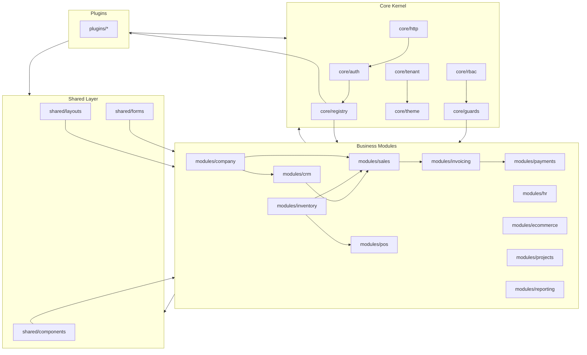

# Module Dependency Diagram

## Overview

This diagram shows how modules relate to each other and to the core system.

## Conceptual Diagram

## Module Dependencies (Backend Mirror)

Based on backend roadmap:

| Module | Dependencies | Reason |
|--------|--------------|---------|
| **company** | None | Base module |
| **crm** | company | Customers/contacts linked to company context |
| **inventory** | company | Products/warehouses |
| **sales** | company, inventory, crm | Orders need products, customers |
| **invoicing** | sales, inventory, company | Invoices from orders |
| **payments** | invoicing, company | Payments against invoices |
| **pos** | sales, inventory, payments, company | Point of sale needs all |
| **hr** | company | Employees |
| **ecommerce** | inventory, sales, payments, company | Online store |
| **projects** | crm, company | Projects for clients |
| **reporting** | All modules (read-only) | Aggregates data |

## Rules

1. **Core has no module dependencies** - Kernel is independent
2. **Modules can depend on Core and Shared** - Always allowed
3. **Modules should not import other modules directly** - Use facades or events
4. **Plugins same rules as modules** - Restricted to core/shared
5. **Dependencies declared in manifest** - Enforced by UI/UX guidance

## Communication Between Modules

When modules need to communicate:
- **Shared types** - Put in `shared/types/` if used by >=2
- **Facades** - Create public API in `modules/X/index.ts`
- **Domain events** - For loose coupling (future)
- **API calls** - Each module calls its own API endpoints

## Notes

- Reporting may need read access to multiple modules but should not create circular dependencies
- Use dependency injection/composition at app level
- Backend enforces module dependencies on subscription
- Frontend shows warnings if dependencies not met
