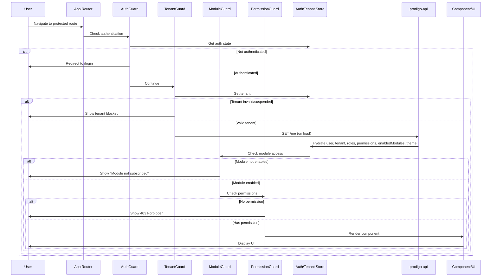
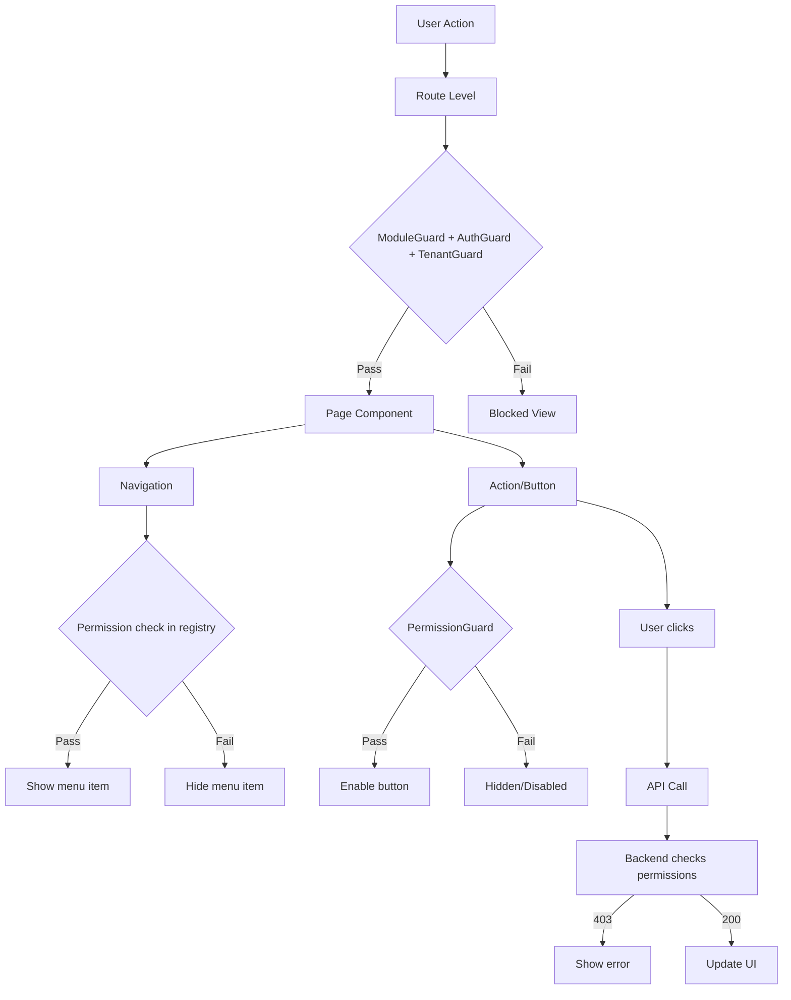
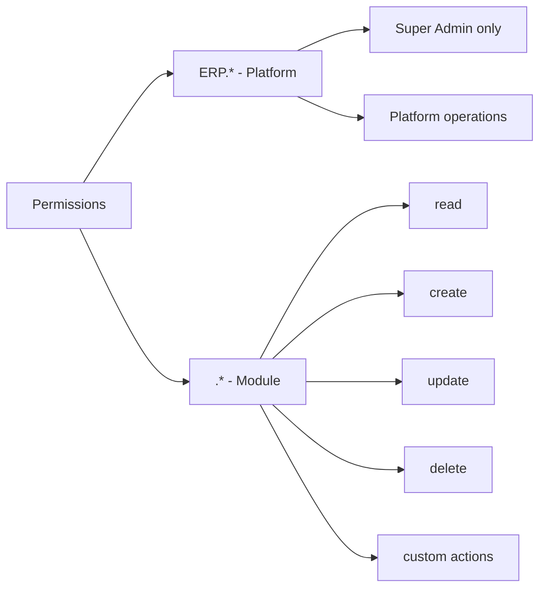

# Permission Flow Diagram

## Overview

This diagram shows how permissions flow from authentication to UI rendering.

## Flow Diagram

## Permission Check Levels

## Permission Types

## Data Sources

| Source | What it provides | Used for |
|--------|------------------|----------|
| **GET /me** | user, tenant, roles, permissions[], enabledModules[], theme | Hydration on app load |
| **useAuthStore** | accessToken, user, isAuthenticated | Auth state |
| **useTenantStore** | tenant, tenantTheme | Tenant context |
| **usePermissions()** | hasPermission, hasModule, etc. | Permission checks |
| **moduleRegistry** | Manifests, filtered nav/routes | Navigation & routing |

## Key Points

1. **Backend is authoritative** - All permission checks must be enforced server-side
2. **Frontend is for UX** - Hide/show for better experience, not security
3. **Multiple layers** - Route, navigation, component, action levels
4. **Fail securely** - Default deny, show 403 on missing permission
5. **Module gate** - Subscription checked before permission
6. **Theme applied** - After tenant loaded

## Testing Scenarios

- [ ] Unauthenticated user → redirected to login
- [ ] Suspended tenant → blocked
- [ ] Unsubscribed module → module not subscribed page
- [ ] No permission → 403
- [ ] Has permission but wrong tenant → backend 403
- [ ] Inactive user → denied
- [ ] Platform admin with ERP.* → can access admin routes
